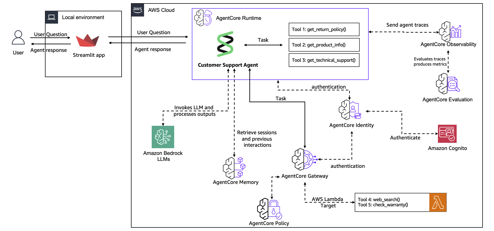

# End-to-End Customer Support Agent with AgentCore

Move a customer support agent from prototype to production using Amazon Bedrock AgentCore services. Across six labs, you'll build a complete system that handles real customer conversations with memory, shared tools, observability, and a web interface.

> [!IMPORTANT]
> This workshop is for educational purposes. It demonstrates how AgentCore services are used when migrating an agentic use case from prototype to production. It is not intended for direct use in production environments.

## Architecture Overview

By the end of the 6 labs, you will have built the following architecture:

<div style="text-align:left">
    
</div>

## Prerequisites

- You need an AWS account with access to Amazon Bedrock.
- [uv](https://docs.astral.sh/uv/getting-started/installation/) must be installed. It manages Python and all dependencies, so you don't need a separate Python installation.
- The AWS CLI must be configured with appropriate credentials.
- `zip` must be available (used by `scripts/prereq.sh` on macOS / Linux).
- Amazon Nova 2 Lite must be enabled in your [Amazon Bedrock model access](https://docs.aws.amazon.com/bedrock/latest/userguide/model-access.html) settings.

## Getting Started

### Install dependencies

From the repository root, create the project environment:

```bash
uv sync
```

This creates a `.venv` folder with Python 3.12 (pinned in `.python-version`, downloaded by uv if needed) and installs the exact versions locked in `uv.lock`: the agent dependencies plus the `notebooks`, `frontend`, and `optional-labs` dependency groups. Run `uv sync` again whenever you pull changes to `pyproject.toml` or `uv.lock`.

Before starting Lab 1, you also need to provision the required infrastructure (Lambda functions, DynamoDB tables, IAM roles, Cognito user pool, and a Bedrock Knowledge Base), as described in the next two sections.

### Required IAM permissions

The IAM user or role behind your AWS credentials (run `aws sts get-caller-identity` to check) must be able to create and delete the resources used across the labs. On a personal sandbox account the simplest option is an identity with the `AdministratorAccess` managed policy. If you need a scoped-down policy, it must cover at least:

| Service                                      | Used for                                                                          |
| -------------------------------------------- | --------------------------------------------------------------------------------- |
| AWS CloudFormation                           | Deploying the prerequisite stacks                                                 |
| AWS IAM                                      | Creating service roles (`CAPABILITY_NAMED_IAM`) and the Runtime execution role    |
| Amazon S3                                    | Bucket for the Lambda code and Lambda layer artifacts                             |
| AWS Lambda                                   | Tool functions and the DDGS layer                                                 |
| Amazon DynamoDB                              | Tables backing the warranty and customer profile tools                            |
| Amazon Cognito                               | User pool and app clients for Gateway and frontend authentication                 |
| AWS Systems Manager Parameter Store          | Sharing resource IDs between labs (`/app/customersupport/*`)                      |
| AWS Secrets Manager                          | Storing Cognito client credentials                                                |
| Amazon Bedrock                               | Model invocation (Amazon Nova 2 Lite) and the Knowledge Base                      |
| Amazon Bedrock AgentCore                     | Memory, Gateway, Identity, Policy, Runtime, and Evaluations                       |
| Amazon ECR and AWS CodeBuild                 | Building and storing the AgentCore Runtime container image                        |
| Amazon CloudWatch and AWS X-Ray              | Logs, traces, and Transaction Search for observability                            |

### Deploy the prerequisite infrastructure

Run the prerequisite script from the repository root:

```bash
bash scripts/prereq.sh          # macOS / Linux
pwsh scripts/prereq.ps1         # Windows
```

The script:

1. Creates an S3 bucket named `customersupport112-<account-id>-<region>`.
2. Packages the Lambda code in `prerequisite/lambda/python` into `lambda.zip`.
3. Builds the DDGS Lambda layer (`ddgs-layer.zip`) from the pinned versions in `prerequisite/lambda/layer-requirements.txt`, using `uv pip install --target` to download Linux x86_64 / Python 3.12 wheels (so it works from any OS).
4. Uploads both archives and deploys two CloudFormation stacks (`CustomerSupportStackInfra` and `CustomerSupportStackCognito`) that provision all the backing resources used across the labs.

The region is taken from `AWS_REGION` or, if unset, from your AWS CLI configuration (default `us-west-2`). The bash script optionally accepts a bucket prefix and the two stack names as positional arguments. The generated archives and the `build/` folder are ignored by git.

### Open the notebooks and start Lab 1

Run the notebooks on the project environment, using one of these options:

- **JupyterLab**: run `uv run jupyter lab` from the repository root.
- **VS Code**: open the folder and select the `.venv` interpreter as the notebook kernel. The workspace settings in `.vscode/settings.json` already point to it.
- **An existing Jupyter server (for example SageMaker Studio)**: install uv there, run `uv sync`, register the environment as a kernel with `uv run python -m ipykernel install --user --name strands-agentcore-workshop`, and select that kernel in each notebook.

Then open [Lab 1](lab-01-create-an-agent.ipynb) and follow along. Each lab builds on the previous one. The notebooks never install packages themselves: the first cells only check that they are running on the uv environment, and command-line tools (Streamlit, OpenTelemetry instrumentation) are launched through `uv run`.

## Labs

| Lab | Title                                                                | Notebook                                   | Time    | What You'll Learn                                         |
| --- | -------------------------------------------------------------------- | ------------------------------------------ | ------- | --------------------------------------------------------- |
| 1   | [Create Agent Prototype](#lab-1-create-agent-prototype)              | [Notebook](lab-01-create-an-agent.ipynb)   | ~20 min | Agent creation with Strands Agents and tool integration   |
| 2   | [Add Memory](#lab-2-add-memory)                                      | [Notebook](lab-02-agentcore-memory.ipynb)  | ~20 min | AgentCore Memory for short-term and long-term persistence |
| 3   | [Scale with Gateway & Identity](#lab-3-scale-with-gateway--identity) | [Notebook](lab-03-agentcore-gateway.ipynb) | ~30 min | AgentCore Gateway and Identity for secure tool sharing    |
| 4   | [Deploy to Production](#lab-4-deploy-to-production)                  | [Notebook](lab-04-agentcore-runtime.ipynb) | ~30 min | AgentCore Runtime with production-grade Observability     |
| 5   | [Evaluate Agent Performance](#lab-5-evaluate-agent-performance)      | [Notebook](lab-05-agentcore-evals.ipynb)   | ~10 min | AgentCore Evaluations for quality monitoring              |
| 6   | [Build User Interface](#lab-6-build-user-interface)                  | [Notebook](lab-06-frontend.ipynb)          | ~20 min | Frontend integration with secure agent endpoints          |

### Lab 1: Create Agent Prototype

Build a customer support agent prototype using Strands Agents and Amazon Nova 2 Lite with four core tools:

- Look up return policies for different product categories.
- Search product information and specifications.
- Search the web for troubleshooting help.
- Query a Bedrock Knowledge Base for technical support documentation.

### Lab 2: Add Memory

Transform your "goldfish agent" into one that remembers customers across conversations using AgentCore Memory:

- Store conversation history persistently with short-term memory.
- Extract customer preferences and behavioral patterns with long-term memory.
- Maintain context awareness across multiple sessions so the agent can personalize responses.

### Lab 3: Scale with Gateway & Identity

Move from local tools to shared, enterprise-ready services using AgentCore Gateway and AgentCore Identity:

- Centralize tool management by exposing Lambda functions as MCP-compatible tools through AgentCore Gateway.
- Secure your gateway endpoint with JWT-based authentication using Amazon Cognito.
- Integrate existing AWS Lambda functions (warranty check, web search) without rewriting tool code.
- (Optional) Define fine-grained access control with Cedar policies using AgentCore Policy to restrict specific tool invocations.

### Lab 4: Deploy to Production

Deploy your agent to AgentCore Runtime to handle real traffic with full observability:

- Deploy your agent to a fully managed, serverless runtime with minimal code changes (only four lines added).
- Enable session continuity and session isolation so each customer gets a separate conversation context.
- Monitor agent behavior through CloudWatch GenAI Observability with automatic tracing and metrics.

### Lab 5: Evaluate Agent Performance

Set up continuous quality monitoring for your production agent using AgentCore Evaluations:

- Configure online evaluation with built-in evaluators for goal success rate, correctness, and tool selection accuracy.
- Generate test interactions and review evaluation results through AgentCore Observability dashboards.
- Use quality metrics to identify areas for improvement and maintain high agent performance.

### Lab 6: Build User Interface

Create a Streamlit web app that customers can use to interact with your deployed agent:

- Provide a chat interface with real-time response streaming powered by AgentCore Runtime.
- Implement secure user authentication through Amazon Cognito.
- Manage user sessions with persistent conversation history via AgentCore Memory.

## Optional Labs

- [Identity Deep Dive](Optional-lab-identity.ipynb) -- Integrate Google Calendar via AgentCore Identity using OAuth2 3LO flows, enabling your agent to create events and retrieve calendars on behalf of authenticated users.
- [Observability Deep Dive](Optional-lab-agentcore-observability.ipynb) -- Set up AgentCore Observability for agents running outside of AgentCore Runtime using AWS OpenTelemetry Python instrumentation and CloudWatch GenAI Observability.

## Managing Dependencies

All Python dependencies are managed with uv:

| File                                         | Purpose                                                                                                         |
| -------------------------------------------- | --------------------------------------------------------------------------------------------------------------- |
| `pyproject.toml`                             | Declares the agent dependencies and the `notebooks`, `frontend`, and `optional-labs` dependency groups           |
| `uv.lock`                                    | Exact, cross-platform versions of every package. Commit it together with any change to `pyproject.toml`         |
| `.python-version`                            | Python version uv uses for the local environment                                                                |
| `requirements.txt`                           | Generated from `uv.lock`, agent dependencies only. AgentCore Runtime builds the container from it in Lab 4. Don't edit it by hand |
| `prerequisite/lambda/layer-requirements.txt` | Pinned packages for the DDGS Lambda layer built by `scripts/prereq.sh`                                          |

To add or update a dependency:

```bash
uv add <package>                     # agent dependency (also shipped to AgentCore Runtime)
uv add --group frontend <package>    # or --group notebooks / --group optional-labs
uv lock --upgrade-package <package>  # upgrade a single locked package
```

After changing the agent dependencies, regenerate `requirements.txt` (Lab 4 also does this right before configuring the Runtime):

```bash
uv export --no-default-groups --no-hashes --no-emit-project --no-header --no-annotate --format requirements-txt -o requirements.txt
```

## Cleanup

When you're done, tear down everything created during the workshop:

1. Run the [Cleanup notebook](lab-07-cleanup.ipynb) to delete the AgentCore resources (Memory, Gateway, Policy, Runtime, ECR repository, execution role, log groups) and the local generated files.
2. Delete the prerequisite infrastructure (CloudFormation stacks and S3 bucket) from a terminal at the repository root:

```bash
bash scripts/cleanup.sh
```

If you passed a custom bucket prefix or stack names to `prereq.sh`, pass the same values to `cleanup.sh`.
